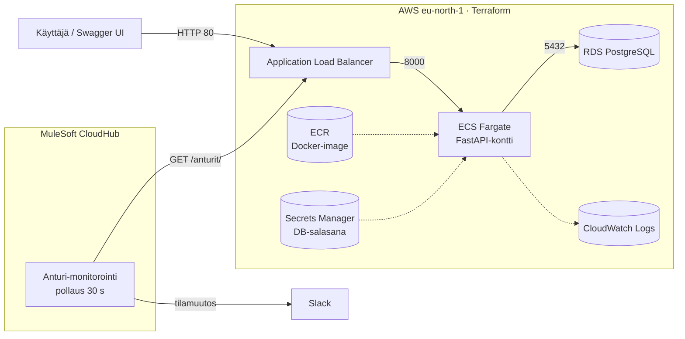
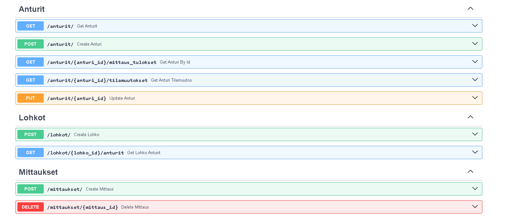

# Anturi API

REST API lämpötila-antureiden datan keräämiseen ja hallintaan. Antureita hallitaan lohkoittain, mittauksia voi hakea aikavälillä, ja anturin tilamuutoksista jää historia.

Aloitin projektin kurssin päättötyönä, jossa tehtävänä oli rakentaa REST API. Kaikki sen jälkeen on omaa jatkokehitystäni, ei osa kurssia: lisäsin testit, kontitin sovelluksen, deployasin sen AWS:ään ja rakensin päälle MuleSoft-integraation, joka hälyttää Slackiin. Käsin konsolista rakennettu ympäristö kulutti turhaan kuluja, joten purin sen ja rakensin koko AWS-infran uudelleen koodina Terraformilla. Seuraavaksi rakennan CI/CD-putken GitHub Actionsilla. Tavoitteena on viedä yksi API koko matkan läpi: **rakennettu → testattu → kontitettu → deployattu → integroitu → infra koodina → automatisoitu. Automatisointivaihe työn alla.**



## Miksi rakensin sen näin

**Tietomalli ensin paperilla.** Hahmottelin resurssit ja niiden suhteet (Lohko → Anturi → Mittaus) paperille ennen koodia. Endpointit seuraavat samaa rakennetta, esim. `/lohkot/{id}/anturit` ja `/anturit/{id}/mittaus_tulokset`, joten API on ennustettava: kun tuntee yhden resurssin polun, arvaa muutkin.

**Tilamuutokset historiaksi, ei pelkäksi kentäksi.** Anturin nykyinen tila ei kerro, milloin vika alkoi tai kuinka usein anturi on ollut virhetilassa. Siksi jokainen tilamuutos kirjataan omaksi rivikseen, mutta vain kun tila oikeasti muuttuu, jotta historiaan ei kerry toistoa. Sama periaate toimii myöhemmin MuleSoft-integraatiossa.

**SQLite kehityksessä, PostgreSQL muualla.** Tietokanta valitaan ympäristömuuttujilla, joten sama koodi toimii paikallisesti ilman asennuksia, Docker Composessa ja AWS:ssä. Paikallisesti käytetään valmista `DATABASE_URL`-osoitetta. AWS:ssä sovellus kokoaa osoitteen muuttujista `DB_HOST`, `DB_NAME`, `DB_USER` ja `DB_PASSWORD`, koska salasana tulee erikseen Secrets Managerista. Ilman muuttujia käytetään SQLiteä. Logiikalla on testi jokaiselle haaralle.

**AWS, vaikka edellinen projektini oli GCP:ssä.** Book API pyöri GCP:n virtuaalikoneella. Tähän halusin toisen pilven ja konttipohjaisen ajon. RDS hoitaa PostgreSQL:n.

**ECS ja Fargate, koska ne vastaavat projektin kokoa.** EC2-virtuaalikoneissa palvelinten ylläpito jäisi minulle, ja EKS eli AWS:n hallinnoitu Kubernetes on tehty paljon suurempiin ympäristöihin kuin yhteen API-palveluun. Elastic Beanstalk olisi pystyttänyt ympäristön automaattisesti, mutta halusin rakentaa ja ymmärtää palaset itse. Fargatella AWS hoitaa konttien alla olevat palvelimet, joten voin keskittyä sovellukseen.

**Load balancer ECS:n eteen.** Fargate-tehtävän IP-osoite vaihtuu aina, kun tehtävä käynnistyy uudelleen. MuleSoft-integraatio tarvitsi pysyvän osoitteen, ja ALB antaa sellaisen DNS-nimen muodossa. Samalla sain health checkin: ALB ohjaa liikennettä vain kontille, joka vastaa `/health`-pyyntöön. Rajoitus: DNS-nimi vaihtuu, kun ALB luodaan uudelleen, joten MuleSoftin osoite pitää päivittää jokaisen uudelleenpystytyksen jälkeen. Pysyvä ratkaisu olisi oma domain Route 53:lla.

**MuleSoft-integraatio.** Halusin APIlle oikean käyttäjän, en pelkkää `/docs`-sivua. Integraatio pollaa anturien tilaa ja lähettää Slackiin hälytyksen vain, kun tila oikeasti muuttuu. Se on sama ongelma kuin oikeissa valvontajärjestelmissä: hälytysten pitää olla harvinaisia ja merkityksellisiä.

**Terraform.** AWS-ympäristö oli alun perin rakennettu konsolista klikkaamalla, ja se kulutti noin 60 $ kuukaudessa ilman, että huomasin sitä. Purin sen ja rakensin saman uudelleen koodina. Ennen uudelleenrakennusta tein erillisen [terraform-aws-practice](https://github.com/waltterir/terraform-aws-practice)-projektin, jossa rakensin S3-bucketin Terraformin statelle ja siirsin sen oman staten paikallisesta tiedostosta S3:een. Samalla opettelin Terraformin peruskierron ja staten hallinnan. Sama bucket toimii nyt tämän projektin staten säilönä.

Nyt ympäristö pystytetään ja puretaan yhdellä komennolla, jokainen muutos näkyy versionhallinnassa, ja `terraform plan` näyttää muutokset ennen kuin mitään tapahtuu. Valitsin Terraformin, koska infrastruktuuri koodina on taito, jota pilvi- ja integraatiorooleissa kysytään yhä useammin.

**GitHub Actions (seuraavaksi).** Nyt testit ajetaan ja image pushataan käsin. Haluan rakentaa putken, joka vie koodin kehityksestä tuotantoon kuten oikeassa tiimissä: ensimmäisenä testit ajetaan automaattisesti jokaisesta pushista, jotta rikkinäinen koodi jää kiinni ennen kuin se etenee. Sen jälkeen putki rakentaa Docker-imagen ECR:ään ja deployaa sen ECS:ään. CI/CD on taito, jonka haluan hallita pitkällä tähtäimellä, ja tämä projekti on siihen sopiva paikka.

**Työskentelytapa.** Rakensin jokaisen Terraform-resurssin itse Terraform Registryn dokumentaation pohjalta enkä valmiista tutoriaalista, joten jouduin ymmärtämään, mitä kukin argumentti tekee. Esimerkiksi target groupin `target_type = "ip"` ja security group -sääntöjen tekeminen erillisinä resursseina löytyivät dokumentaatiosta, eivät esimerkeistä. Opettajana käytin Claudea: pyysin selityksiä ja vihjeitä valmiin koodin sijaan, ja se tarkisti kirjoittamani koodin ja kertoi, mikä siinä oli vialla ja miksi. Kirjoitin infran ja sovelluksen muutokset itse.

## Mitä opin matkan varrella

### Sovellus

- **Tilat Enumiksi.** Aluksi anturin tilaksi kelpasi mikä tahansa merkkijono, myös "Banaani". Enumilla sallitut tilat lukittiin, jolloin virheellinen arvo hylätään jo validoinnissa ja API:n vastaukset ovat ennustettavia.
- **Response-mallit useammasta kyselystä.** Opin rakentamaan omia vastausmalleja (esim. `AnturiMittausResponse`), joilla yksi endpoint palauttaa yhdistettyä dataa useasta taulusta, esim. anturin tiedot ja sen mittaukset samassa vastauksessa.
- **Mule-flow ei muista mitään pollausten välillä.** Tilanvertailua varten tarvitsin Object Storen.

### Pilvi ja infra

- **Ensimmäinen deploy kaatui**, koska `DATABASE_URL`-ympäristömuuttujaan oli jäänyt vahingossa kulmasulkeet. Opin lukemaan ECS-tehtävien lokit ja tekemään korjauksen uutena task definition -revisiona.
- **API ei vastannut ulospäin**, vaikka kontti oli käynnissä. Vika oli ALB:n security groupissa, joka ei sallinut julkista HTTP-liikennettä. Verkkokerros kannattaa tarkistaa ennen sovelluskoodia.
- **Pieni muutos voi korvata paljon.** Muutin kahden security groupin kuvausta, ja `terraform plan` näytti, että se korvaisi 2 security groupia ja 5 sääntöä ketjureaktiona, koska kuvausta ei voi muuttaa paikallaan. Plan pysäytti sen ennen applya. Nyt luen `-/+`- ja `# forces replacement` -rivit aina ennen applya.
- **Viittaukset ratkaisevat järjestyksen.** Kun resurssi viittaa toisen attribuuttiin (esim. task definition RDS:n osoitteeseen), Terraform päättelee luonti- ja purkujärjestyksen itse. Kovakoodattu arvo rikkoisi tämän.
- **Health check tarvitsee oman reitin.** ALB merkitsi kontin sairaaksi, koska juuripolkua `/` ei ollut. Lisäsin `/health`-endpointin testeineen.
- **Jumittunut state-lukko.** Keskeytynyt `terraform init` jätti lukkotiedoston S3:een. Varmistin, ettei muita ajoja ollut käynnissä, ja poistin lukon manuaalisesti.

## Tilanne nyt

- [x] API, testit, Docker ja PostgreSQL
- [x] AWS-deploy käsin (ECR → ECS Fargate → RDS, ALB edessä). Purettu kustannussyistä.
- [x] MuleSoft-integraatio CloudHubissa. Pysäytetty, kun ympäristö ei ole pystyssä.
- [x] AWS-infra koodiksi Terraformilla. Pystytetään ja puretaan tarpeen mukaan.
- [ ] CI/CD GitHub Actionsilla

## Ominaisuudet

- Tietomalli: **Lohko → Anturi → Mittaus**
- Antureiden, lohkojen ja mittausten CRUD
- Tilamuutosten automaattinen kirjaus (sama tila uudelleen ei luo turhaa merkintää)
- Mittausten aikavälisuodatus (`start_time`, `end_time`) ja paginointi (`page`, `limit` ≤ 100)
- Virhetilassa olevan anturin mittauksia ei palauteta (409)
- `/health`-endpoint load balancerin terveystarkistukseen

```
GET /anturit/{anturi_id}/mittaus_tulokset?page=1&limit=10
```

```json
{
  "anturi": {
    "id": 1,
    "anturi_name": "Anturi 32",
    "lohko_id": 1,
    "tila": "error"
  },
  "mittaukset": [
    {
      "id": 1,
      "anturi_id": 1,
      "mittaus_arvo": 20.5,
      "aikaleima": "2026-04-02T10:31:26.623000"
    }
  ]
}
```

## Testit

Pytest + FastAPI TestClient. Testit kattavat onnistuneiden polkujen lisäksi virhetilanteet: olemattomat resurssit (404), virheelliset aikavälit ja paginoinnin rajat, tilamuutoshistorian ja virhetilassa olevan anturin käsittelyn, lisäksi tietokantaosoitteen valinnan kaikilla neljällä haaralla ja `/health`-endpointin.

```bash
python -m pytest -v
```

## Aja paikallisesti

**Docker Composella (PostgreSQL)**, suositeltu:

```bash
docker compose up -d --build
```

**Ilman Dockeria (SQLite):**

```bash
python -m venv .venv
.venv\Scripts\activate          # Windows
pip install -r requirements.txt
uvicorn app.main:app --reload
```

Käynnistyksen jälkeen API-dokumentaatio löytyy osoitteesta `http://localhost:8000/docs`.



## Infra (Terraform)

Koko AWS-ympäristö on koodina kansiossa `infra/`. Terraformin state on S3-bucketissa (versiointi ja lukitus), joka on luotu erillisessä [terraform-aws-practice](https://github.com/waltterir/terraform-aws-practice)-projektissa. Sovelluksen infraa puretaan usein, mutta state-bucketia ei koskaan, joten ne ovat eri projekteissa.

**Tietoturva**

- Jokainen kerros päästää sisään vain edellisen: internet → ALB (80) → ECS (8000) → RDS (5432). Tietokantaan ei pääse internetistä, eikä se voi itse lähettää liikennettä ulos.
- Tietokannan salasana: RDS generoi sen Secrets Manageriin, ja ECS antaa sen kontille ympäristömuuttujana. Salasana ei ole koodissa, Gitissä eikä Terraformin statessa.
- ECS:n rooli saa lukea vain tämän yhden salaisuuden (least privilege).
- RDS:n levy on salattu.

**Pystytys ja purku**

```bash
cd infra
terraform apply -target=aws_ecr_repository.anturi_api   # 1. tyhjä ECR-repo
# 2. docker build, tag ja push ECR:ään
terraform apply                                          # 3. kaikki muu
terraform output alb_url                                 # Swaggerin osoite
terraform destroy                                        # purku, kun ympäristöä ei tarvita
```

| Tiedosto                      | Sisältö                                        |
| ----------------------------- | ---------------------------------------------- |
| `versions.tf`, `providers.tf` | provider ja S3-backend                         |
| `network.tf`                  | default VPC ja aliverkot (data sources)        |
| `security.tf`                 | security groupit ALB:lle, ECS:lle ja RDS:lle   |
| `iam.tf`                      | ECS:n execution role ja salaisuuden lukuoikeus |
| `database.tf`                 | RDS PostgreSQL ja subnet group                 |
| `ecs.tf`                      | klusteri, task definition ja service           |
| `alb.tf`                      | load balancer, target group ja listener        |
| `logs.tf`                     | CloudWatch log group, 3 päivän säilytys        |

## MuleSoft-integraatio

Erillinen Anypoint-projekti, joka on deployattu CloudHubiin.

```
Scheduler (30 s) → GET /anturit/ → DataWeave
→ For Each anturi → Object Store: edellinen tila
→ normal → error:  Slack ALERT
→ error → normal:  Slack RECOVERY
→ ei muutosta:     ei viestiä
→ Object Store: tallenna nykyinen tila
```

Slack-viestit lähtevät Incoming Webhookilla.

```
ALERT: Anturi PannuHuone (id: 2, lohko: 2) meni error-tilaan!
RECOVERY: Anturi PannuHuone (id: 2, lohko: 2) palautui normal-tilaan!
```

## Rakenne

```text
app/
├── main.py
├── routes/       # endpointit
├── models/       # SQLModel-mallit
├── crud/         # tietokantaoperaatiot
├── database/     # DB-alustus
└── tests/        # pytest-testit
infra/            # AWS-infra Terraformilla
compose.yaml      # API + PostgreSQL paikallisesti
Dockerfile
requirements.txt
pytest.ini
```

## Teknologiat

Python · FastAPI · SQLModel · PostgreSQL · SQLite · pytest · Docker · Terraform · AWS (ECR, ECS Fargate, RDS, ALB, Secrets Manager, CloudWatch, IAM) · MuleSoft (Anypoint, DataWeave, CloudHub) · Slack
